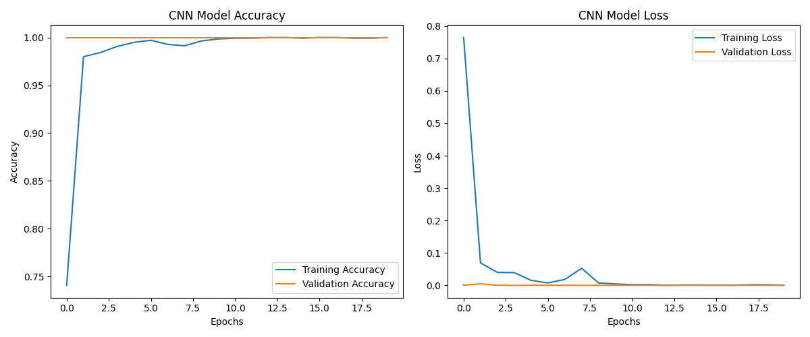

# Real-Time Sign Language Detection

A real-time sign language recognition system that uses a webcam to find a hand, classifies the gesture with a custom-trained CNN, and shows the result live with its confidence score. The project covers the full pipeline: dataset creation, model training, and live inference.
---

## Features

- **Automated dataset collection:** captures webcam images per gesture and crops the hand region automatically using MediaPipe hand landmarks
- **Custom CNN classifier:** 3-block convolutional network built with TensorFlow/Keras
- **Data augmentation:** rotation, width/height shifts and zoom to reduce overfitting
- **Smart training:** early stopping, best-model checkpointing and learning-rate reduction on plateau
- **Real-time inference:** live webcam detection with hand bounding box and landmark overlay
- **Prediction filtering:** confidence threshold plus a 3-frame stability filter to avoid flickering predictions
- **Live feedback:** gesture name, confidence percentage, top-3 predictions, and a detection history log

---

## How It Works

```
Webcam frame
    -> MediaPipe Hands (locate hand, 21 landmarks)
    -> Bounding box around landmarks (+30 px padding) -> crop
    -> Resize to 128x128, convert BGR to RGB, normalize to [0, 1]
    -> CNN (softmax over 7 classes)
    -> Confidence threshold + 3-frame stability filter
    -> Display gesture, confidence and history
```

MediaPipe is used to **locate and crop the hand**; the CNN performs the actual gesture classification on the cropped image.

---

## Tech Stack

| Area | Tools |
|---|---|
| Language | Python |
| Deep learning | TensorFlow, Keras |
| Computer vision | OpenCV, MediaPipe Hands |
| Data / plotting | NumPy, Matplotlib |

---

## Dataset

- **Gestures:** 7 classes (hello, no, please, sorry, thank_you, yes, i love you)
- **Images per gesture:** 250 (about 1,750 images in total; confirm against the count printed by the training script)
- **Image size:** 128 x 128 RGB, hand region only
- **Collection:** captured from a webcam with the included collection script, one folder per gesture inside `dataset/`
- **Split:** 80% training / 20% validation (`validation_split=0.2`, seed 42)

The dataset is not included in this repository. Create your own using the collection script (see Usage).

---

## Model

| Layer | Details |
|---|---|
| Input | 128 x 128 x 3 |
| Conv2D + MaxPool | 32 filters, 3x3, ReLU, pool 2x2 |
| Conv2D + MaxPool | 64 filters, 3x3, ReLU, pool 2x2 |
| Conv2D + MaxPool | 128 filters, 3x3, ReLU, pool 2x2 |
| Flatten | |
| Dropout | 0.5 |
| Dense | 256 units, ReLU |
| Output | Dense, 7 units, softmax |

**Training setup**

- Optimizer: Adam (default learning rate)
- Loss: categorical cross-entropy
- Batch size 32, up to 20 epochs
- Augmentation (training only): rotation up to 15 degrees, width/height shift 10%, zoom 10%
- Callbacks: EarlyStopping (monitor `val_loss`, patience 5, restore best weights), ModelCheckpoint (best `val_loss`), ReduceLROnPlateau (factor 0.5, patience 3)

---

## Results

| Metric | Value |
|---|---|
| Validation accuracy | [X]% |
| Validation loss | [X] |

Training curves are saved by the training script as `training_results.png`:



> Validation data comes from the same capture session as the training data, so these numbers are likely higher than real-world performance. See [Limitations](#limitations).

---

## Installation

```bash
git clone https://github.com/Shahana2421/Sign-Language-Detection.git
cd Sign-Language-Detection

python -m venv venv
source venv/bin/activate        # Windows: venv\Scripts\activate

pip install opencv-python mediapipe tensorflow numpy matplotlib
```

Tested with: Python [x.x], TensorFlow [x.x], MediaPipe [x.x]. A working webcam is required.

---

## Usage

**1. Collect data**

```bash
python 1_collect_data.py
```

For each gesture, the script shows the webcam feed. Press `SPACE` to start capturing 250 images, or `Q` to quit early. Tips for better data: use good lighting, a plain background, and vary the hand distance and angle slightly.

**2. Train the model**

```bash
python 2_train_model.py
```

Saves `sign_model.h5` (best model), `class_labels.npy` (class index to name mapping) and `training_results.png`.

**3. Run real-time detection**

```bash
python 3a_detect_top3.py        # shows all 7 gestures with confidence and top-3 predictions
python 3b_detect_history.py     # shows Hello/No on screen and logs all 7 gestures in a history panel
```

| Key | Action |
|---|---|
| `Q` | Exit |
| `R` | Clear detection history (history version only) |

---

## Configuration

| Setting | Top-3 version | History version |
|---|---|---|
| Image size | 128 | 128 |
| Confidence threshold | 0.50 | 0.90 |
| Stable frames required | 3 | 3 |
| MediaPipe detection confidence | 0.70 | 0.75 |
| MediaPipe tracking confidence | 0.60 | 0.60 |
| Max hands | 1 | 1 |
| History length | n/a | last 5 detections |

---

## Project Structure

```
Sign-Language-Detection/
├── 1_collect_data.py        # webcam data collection with automatic hand cropping
├── 2_train_model.py         # CNN training, evaluation and training plots
├── 3a_detect_top3.py        # real-time detection with confidence and top-3 predictions
├── 3b_detect_history.py     # real-time detection with detection history panel
├── sign_model.h5            # trained model (generated by training)
├── class_labels.npy         # label mapping (generated by training)
├── training_results.png     # accuracy/loss curves (generated by training)
└── dataset/                 # collected images, one folder per gesture (not included)
```

---

## Limitations

- **Static gestures only:** each prediction uses a single frame, so signs that depend on hand motion cannot be modeled.
- **Small, custom dataset:** about 250 images per gesture, captured in limited conditions, so the model may not generalize to other people, lighting or backgrounds.
- **Optimistic validation score:** the validation set is a random split from the same capture session, so it likely overestimates real-world accuracy. There is no separate test set.
- **Not a full sign language translator:** it recognizes 7 gestures only.

## Future Improvements

- Collect data from multiple people, backgrounds and lighting conditions
- Hold out a separate test set from a different session or person, and report a confusion matrix and per-class precision/recall
- Use MediaPipe landmark coordinates or sequences of frames with an LSTM to support dynamic gestures
- Try transfer learning (for example MobileNetV2) for better accuracy with less data
- Add text-to-speech output and a web interface (Streamlit)

---

## Author

Shahana S, [GitHub](https://github.com/Shahana2421)
